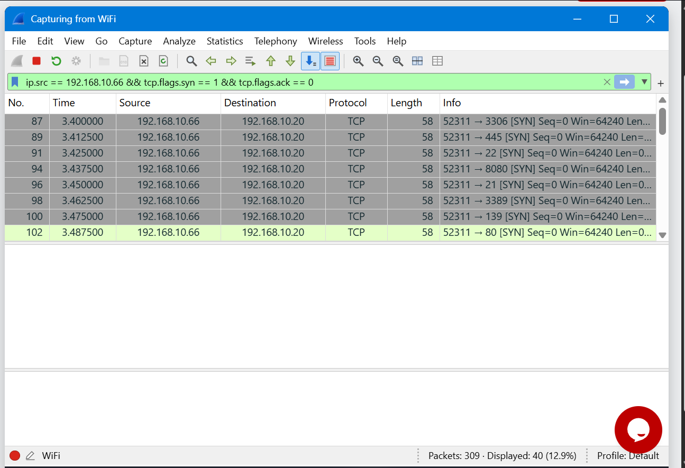
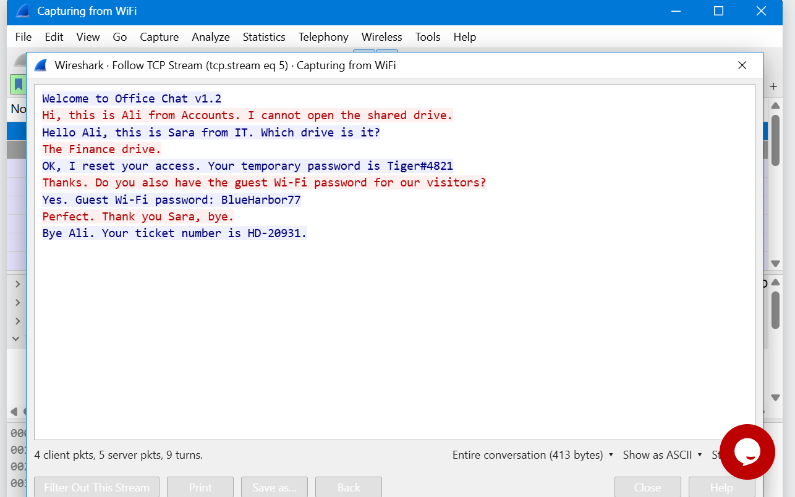
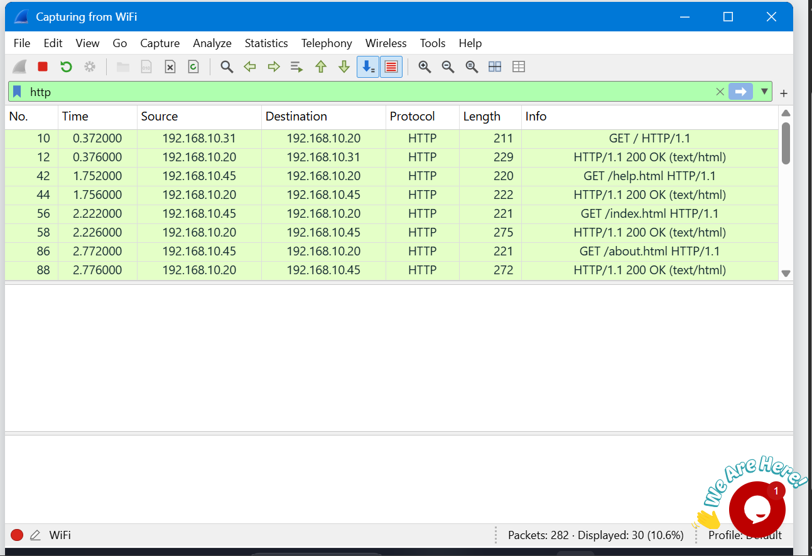
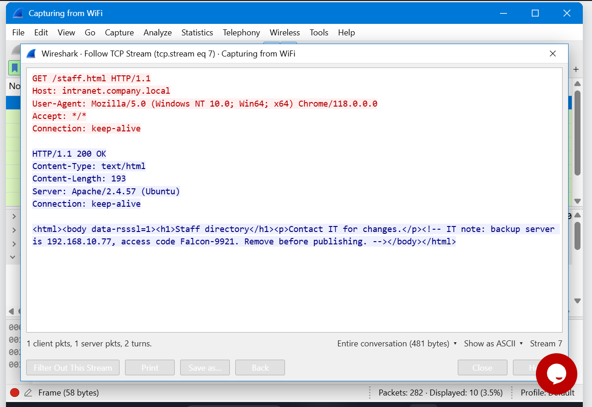
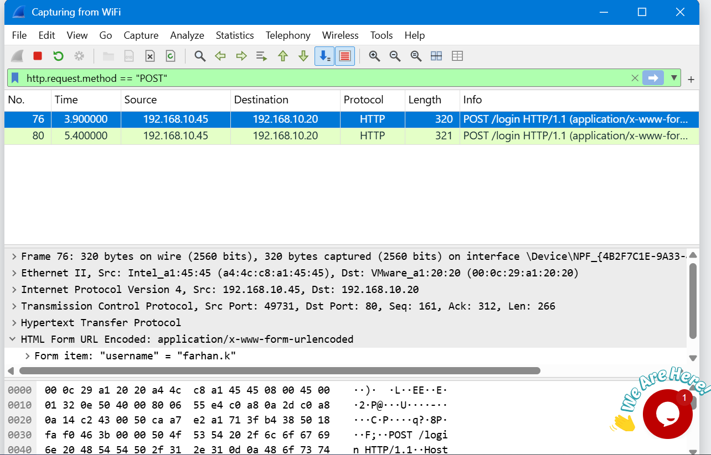
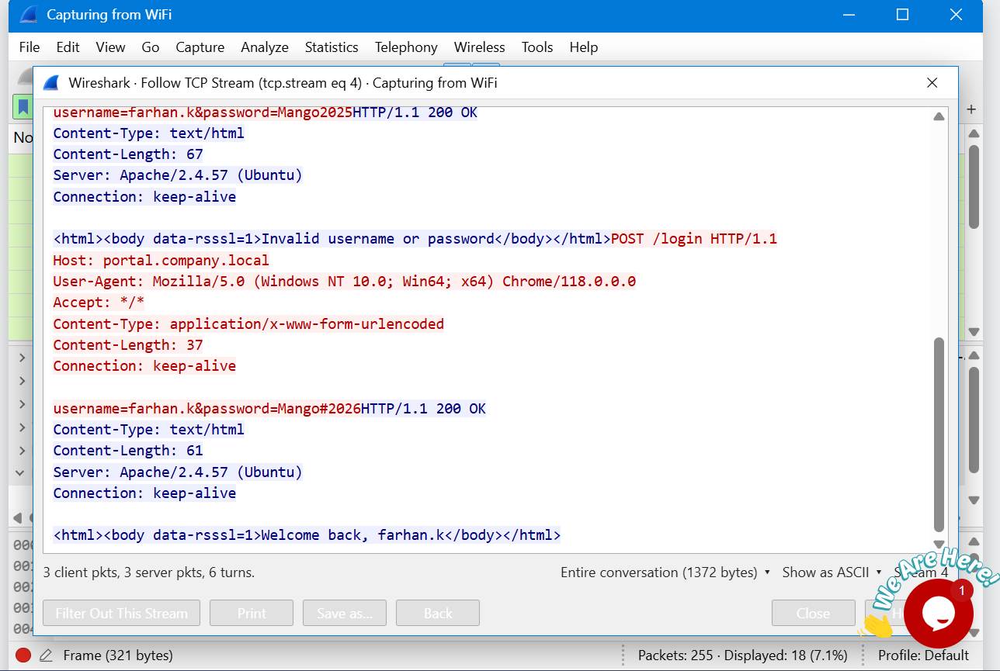
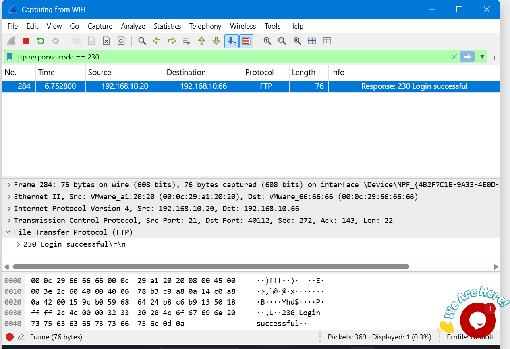
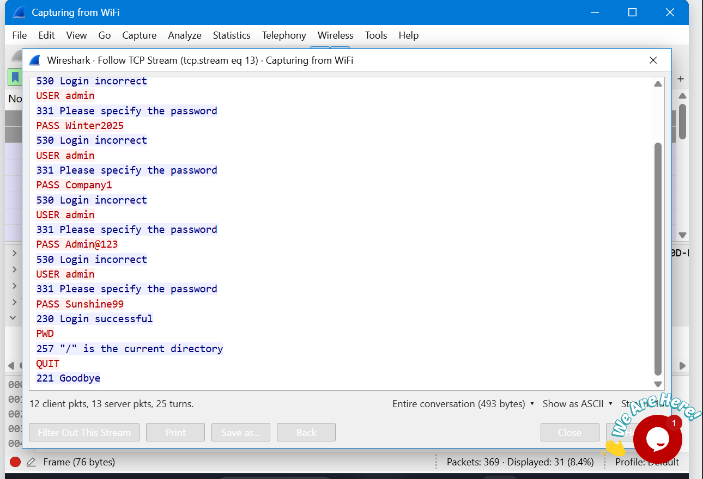
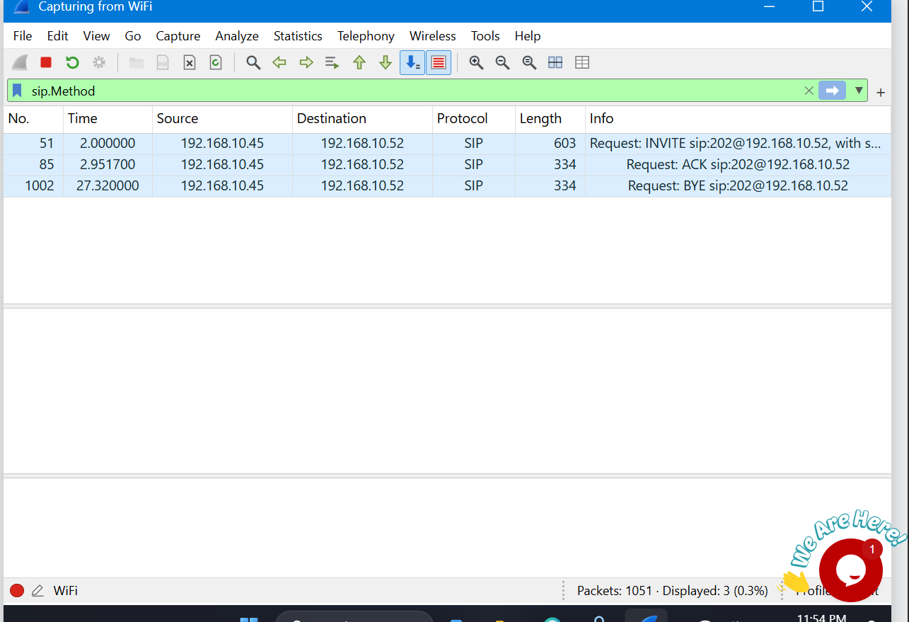
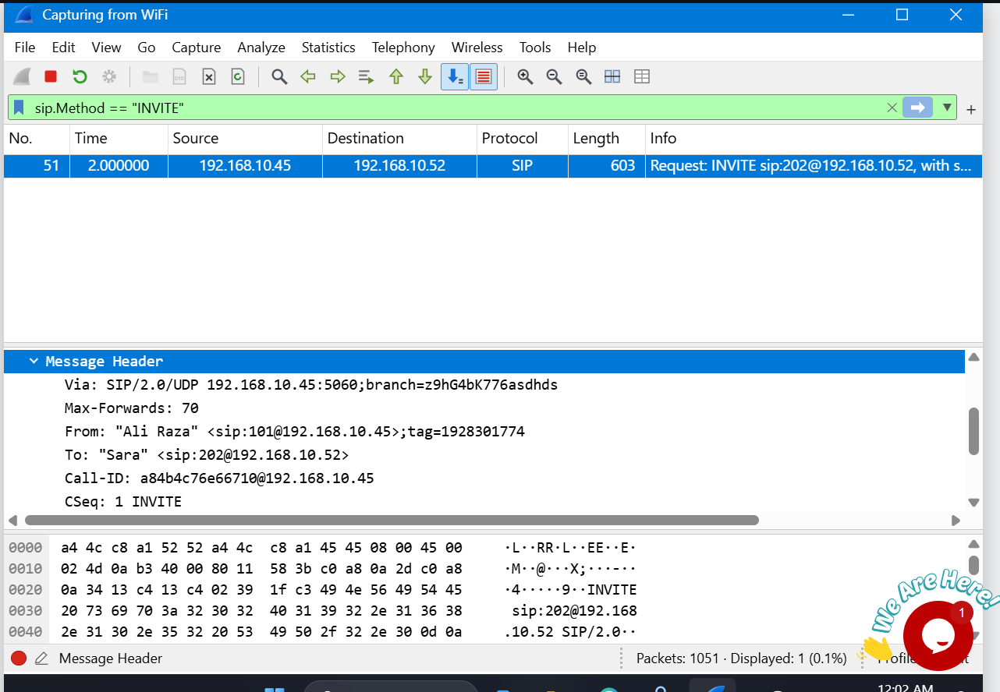

# Wireshark-labs

---

  

  
  
  
  

  🔍 Packet Analysis &nbsp;•&nbsp; 🛡️ Blue Team &nbsp;•&nbsp; 🕵️ Threat Hunting &nbsp;•&nbsp; 🔐 Credential Exposure

---

Hands-on Wireshark labs where I investigate network captures as a SOC analyst, tracking attackers, hidden data, exposed passwords, and a scam call.

---

## 🛠️ Skills practiced
`packet analysis` `display filters` `Follow TCP Stream` `HTTP` `FTP` `SIP/RTP` `incident write-ups`

---

| Lab | Topic | Key skill |
|-----|-------|-----------|
| 03 | Identify the attacker's IP | Spotting a SYN port scan and open/closed ports |
| 04 | Follow TCP Stream | Reading a plain text chat on TCP port 5000 |
| 05 | Follow TCP Stream, part 2 | Finding a hidden note in an HTTP page |
| 06 | HTTP plain text credentials | Finding login POSTs in unencrypted traffic |
| 07 | FTP brute force catch | Spotting failed logins (530) and the success (230) |
| 08 | VoIP call replay | Decoding SIP and RTP and replaying a call |

---

> Note: all IPs, usernames, and passwords in this repo come from practice lab
> captures and are not real credentials.

---

# Lab 3: Identify the Attacker's IP

## Scenario
You are a SOC analyst. A staff member reported unusual traffic to the
company's web server. I captured the packets and analyzed them in Wireshark
to find the type of attack and the attacker's IP address.

## Findings
- Attacker: 192.168.10.66
- Target: 192.168.10.20
- Attack type: port scan (one source port, 52311, probing 40 destination ports)
- Open ports: 22, 80, 443 (SYN, ACK)
- Closed ports: 37 (RST, ACK)

## Key filter
tcp.flags.syn == 1 && tcp.flags.ack == 0

## Lesson
One source sending SYNs to many ports on one target is a port scan.
Defenses: firewall rules, rate limiting, and an IDS/IPS.

---

# Lab 4: Follow TCP Stream

## Scenario
You are a SOC analyst. Your manager says some staff use an old office chat
tool that sends messages in plain text. I captured the traffic and used
Follow TCP Stream to read one chat and see what was shared.

## Findings
- Chat port: TCP 5000 (the rest of the traffic was web on ports 80 and 443)
- Started by: 192.168.10.45
- Stream: tcp.stream eq 5
- Conversation size: 413 bytes (4 client packets, 5 server packets, 9 turns)
- Colors in Follow TCP Stream: red is the client (the PC that started the chat)
- What was shared: a staff member asking for help with the Finance drive,
  and passwords shared in plain text 

## Key filter
tcp.port == 5000

## Lesson
Plain text chat tools expose every message to anyone capturing traffic, including
passwords. Use an encrypted messaging tool (TLS) instead.

# Lab 5: Follow TCP Stream, Part 2

## Scenario
A staff member browsed the company intranet. An admin thought someone left a
secret inside one of the web pages. I captured the traffic and used Follow
TCP Stream to find the hidden text.

## Findings
- Packets captured: 282 (the http filter showed 30)
- Pages opened: 5
- Page with the hidden note: /staff.html
- Stream: tcp.stream eq 7 (server replied 200 OK)
- Where it was hidden: an HTML comment, invisible in a browser but plain to
  see in the stream
- Direction: server to client (blue text in Follow TCP Stream)
- The access code word
- Downloaded text file: /download/report.txt (stream 11), which showed who
  prepared the report

## Key filter
http

---

## Lesson
Hidden text in a page's source is invisible in the browser but fully readable
in a capture. Never put secrets or access codes in HTML. Anything the server
sends can be read by anyone who can capture the traffic.

---

# Lab 6: HTTP Plain Text Credentials

## Scenario
An old staff portal still runs on plain HTTP. I captured the traffic to see
what a person can read from a sign-in that is not encrypted.

## Findings
- Packets captured: 255 (http.request showed 13 requests)
- Protocol: HTTP
- Method: POST
- Login page: /login
- PC that signed in: 192.168.10.45
- Sign-in attempts: 2 (the second worked, the page said "Welcome back")
- Username: farhan.k
- The Password
- Packet details line: HTML Form URL Encoded, which shows the typed values in
  clear text

## Key filter
http.request.method == "POST"

---

## Lesson
Credentials sent over HTTP are readable by anyone who can capture the traffic.
Use HTTPS (TLS) so the form data is encrypted on the wire, redirect HTTP to
HTTPS, enable HSTS, and add multi-factor authentication.

---

# Lab 7: Brute Force Catch

## Scenario
The FTP server owner reported many failed sign-ins in a short time. I captured
the traffic to find who was guessing passwords and whether the attacker got in.

## Findings
- Packets captured: 369 (FTP made up 117, confirmed in Protocol Hierarchy)
- Protocol: FTP
- Target (FTP server): 192.168.10.20
- Attacker: 192.168.10.66
- Username guessed: admin, with many different passwords
- Failure code: 530 (Login incorrect)
- Failed logins: 24
- Not a failure: 331 ("Please specify the password") is the server asking
  for the password
- Success code: 230 (Login successful), so the attacker got in
- Password that worked: Sunshine99
- Attack type: brute force

## Key filter
ftp.response.code == 530

---

## Lesson
FTP sends usernames and passwords in plain text, and the server allowed
unlimited guesses. Lock accounts or block IPs after repeated failures (for
example fail2ban), use strong passwords, add MFA where possible, and replace
FTP with SFTP or FTPS.

# Lab 8: VoIP Call Replay

## Scenario
A phone call was made through the company VoIP system. I captured the traffic,
found the call, and played it back to learn what was said.

## Findings
- Packets captured: 1051
- Signaling protocol: SIP (call flow: INVITE, 100 Trying, 180 Ringing,
  200 OK, ACK, then BYE and 200 OK to end the call)
- Voice protocol: RTP (many small packets, one every 60 ms)
- Codec: G.711 PCMU (RTP payload type 0)
- Call: from 192.168.10.45 to 192.168.10.52
- Caller: Ali Raza
- Who answered: Sara
- Playback: RTP Player (Telephony menu)
- Sensitive data spoken on the call

## Key filter
sip.Call-ID

---

## Lesson
The voice traveled as unencrypted RTP, so anyone who captured the traffic could
replay the call and hear sensitive details. Use SRTP for the audio, SIP over
TLS for signaling, and keep voice traffic on a separate VLAN.
